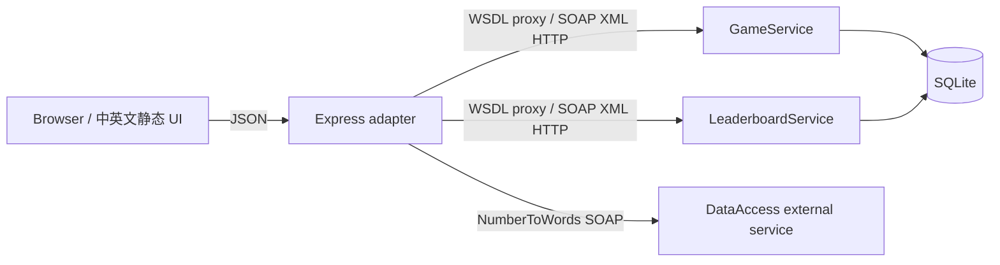

# 课程演示与报告材料

## 组成及边界

明确列出两个自建 SOAP 服务和一个真实外部 SOAP 服务。若教师要求两个外部服务，当前组合不能宣称满足，需要另行确认；不要增加无关服务凑数。



## 10 分钟演示

1. 0:00–1:00：介绍需求与调用链，强调所有核心操作经过 HTTP SOAP。
2. 1:00–2:00：浏览器打开两个 `?wsdl`，SoapUI 导入，查看 document/literal、SOAP 1.1、命名空间。
3. 2:00–4:00：网页游玩，展示服务调用记录；切换语言、刷新恢复、移动端滑动或方向按钮。
4. 4:00–6:00：运行 `npm.cmd run evidence`，该脚本在独立临时库注入清楚标注的终局 fixture，真实 SOAP 依次调用八个方法，保存 XML。不伪装成自然打到 2048。展示提交可信分数及重复提交测试。
5. 6:00–7:00：展示外部 WSDL 和实际 NumberToWords 请求。当前网络实测连接重置；如现场重试仍失败，说明外部未通过成功调用验收，展示降级及原始失败记录，不能展示 fixture 冒充外部响应。
6. 7:00–8:30：`npm.cmd test`，解释版本冲突、幂等、SQLite 重启持久化和 BigInt 分数。
7. 8:30–9:30：浏览器截图与设计改进：静态双语、独立外部降级、完整 SOAP 证据。
8. 9:30–10:00：贡献与限制，答疑。

## 可复制 API 演示

```powershell
$base='http://127.0.0.1:8080'
$g=Invoke-RestMethod "$base/api/games" -Method Post -ContentType 'application/json' -Body (@{requestId=[guid]::NewGuid().ToString()}|ConvertTo-Json)
$body=@{requestId=[guid]::NewGuid().ToString();expectedVersion=$g.game.version;direction='LEFT'}|ConvertTo-Json
Invoke-RestMethod "$base/api/games/$($g.game.gameId)/moves" -Method Post -ContentType 'application/json' -Body $body
Invoke-RestMethod "$base/api/leaderboard?limit=10"
Invoke-RestMethod "$base/api/scores/2048/words"
```

最后一条在当前网络可能返回 503；这是实测限制。页面仍可玩、榜单仍可用。直接 SOAP 可以在 SoapUI 中导入 `contracts/game.wsdl`，将 endpoint 设为运行端口，复制 `docs/soap-samples/*-request.xml` 并更新 requestId、gameId、expectedVersion。样例响应的 UUID 是独立证据库中的真实值，不是当前运行库的 ID。每次修改参数请换 requestId。

## SOAP 契约摘要

- 命名空间：`http://webservice.example.com/2048/game/v1`、`http://webservice.example.com/2048/leaderboard/v1`。
- 本地 operation 的 SOAPAction 为 `命名空间/操作名`。请求包装元素为 `OperationRequest`，响应为 `OperationResponse`。
- requestId 必须 UUID。board.cell 按行排列 16 个 xsd:long。score 为 xsd:long，JSON 字符串。
- 响应业务错误包含 success=false/errorCode/requestId；协议错误由 SOAP Fault 或拒绝请求处理。JSON 映射 400 参数、404 游戏不存在、409 冲突、503 SOAP/外部不可用、500 内部失败。
- 外部 namespace `http://www.dataaccess.com/webservicesserver/`，SOAPAction 为官方 WSDL 中的空字符串，NumberToWords.ubiNum 为 unsignedLong。

## 代码讲解位置

| 文件 | 讲解点 |
|---|---|
| src/domain.js | 压缩、单轮一次合并、四方向、分数 |
| src/store.js | SQLite 事务、请求指纹、版本、终局封存、可信成绩 |
| src/soap.js | 从 WSDL 发布两个服务，生成客户端，SOAP 调用日志 |
| src/server.js | JSON 适配只能调用代理，非领域直调 |
| src/words.js | 官方 WSDL binding、超时重试、缓存和失败降级 |
| public/app.js / i18n.js | 服务端棋盘显示、恢复、静态双语 |

## 验收与报告诚实边界

本地八个方法已采集真实请求/响应；测试 fixture 与正常运行数据库隔离。外部真实成功响应仍待网络条件允许后补充。未人工运行 SoapUI GUI 导入验收，但相同 WSDL 已由独立 node-soap 客户端解析并调用。未实现可选撤销与音效。

分工表需由实际组员填写，不能伪造：

| 姓名 | 实际负责模块 | 可核验贡献 |
|---|---|---|
| 待填写 | 待填写 | 待填写 |

验证日期：2026-11-02（Asia/Shanghai）。XML 和 JSON 内时间为 UTC。
